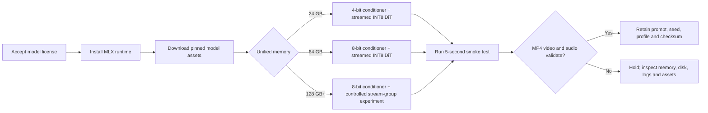

# MiniMax H3 Local Setup on Apple Silicon Macs

**Status:** Source-backed setup guide, updated 2026-10-18

**Audience:** Operators installing MiniMax H3 on Apple Silicon Macs with 24 GB, 64 GB, or 128 GB or more unified memory

**Scope:** Local text-to-video-and-audio generation on macOS using MLX

## Purpose and capability boundary

This guide provides a reproducible local setup for the open-weight MiniMax H3 video model. It covers:

- a conservative, streamed configuration for a 24 GB M4 MacBook Air;
- a higher-quality streamed configuration for a 64 GB M1 Max MacBook Pro;
- a hardware-aware 128 GB profile and controlled performance experiment for an M2 Ultra Mac Studio;
- storage, model licensing, verification, thermal, memory, and recovery guidance;
- the roles of MLX, Ollama, ComfyUI, and hosted MiniMax services.

MiniMax H3 is not a language model. It combines a 33B diffusion transformer, a Qwen3-VL-32B conditioner, video and audio VAEs, and a scheduler to generate video and synchronized stereo audio. It therefore cannot be loaded by Ollama as an ordinary GGUF language model. The Ollama project stated in February 2026 that it did not support video models.[^ollama-video]

This guide uses the community-maintained `Argus-AiTeam/minimax-h3-mac` MLX runtime because it has a documented low-memory path and a measured 24 GB result. The model weights remain governed by the MiniMax H3 Community License; review the current license before downloading, using, or redistributing weights or outputs.[^h3-model][^argus]

### Evidence boundary

- The published 24 GB benchmark used an **M4 Pro MacBook Pro**, not an M4 MacBook Air. It generated a 5.17-second, 768×448 clip in approximately 23 minutes with about 12 GB maximum RSS. The M4 Air instructions below are a conservative extrapolation, not a direct measured Air benchmark.[^argus]
- A completed local **M1 Max 64 GB** test using this guide generated a 5.17-second, 768×448 clip in 24.6 minutes with an 8-bit conditioner, calibrated INT8 DiT, native MLX Turbo adapter, and eight denoiser evaluations. The retained profile reported approximately 158 seconds per evaluation. This is direct evidence for that one configuration, not a general M1 Max guarantee.
- The 128 GB profile has not yet been measured on the target M2 Ultra. Apple specifies up to 128 GB or 192 GB unified memory and 800 GB/s memory bandwidth for that Mac Studio generation.[^m2-ultra]
- Apple specifies the M4 MacBook Air at 120 GB/s memory bandwidth and the M1 Max MacBook Pro at up to 400 GB/s with up to a 32-core GPU.[^m4-air][^m1-max]
- Actual times vary with resolution, steps, quantization, SSD speed, macOS/MLX versions, cooling, and whether blocks are streamed from disk.

## Configuration summary

| Machine | Recommended conditioner | DiT | Loading | Starting canvas | Intended use |
| --- | --- | --- | --- | --- | --- |
| M4 MacBook Air, 24 GB | Locally converted 4-bit | Calibrated INT8 | Streamed, one stage at a time | 768×448 | Short text-to-video tests and occasional clips |
| M1 Max MacBook Pro, 64 GB | Locally converted 8-bit | Calibrated INT8 | Streamed, one stage at a time | 768×448, then 1344×768 | Better prompt adherence and final-quality experiments |
| M2 Ultra Mac Studio, 128 GB | Locally converted 8-bit | Calibrated INT8 | Streamed; group 1 baseline, group 2 experiment | 768×448 comparison, then 1344×768 | Benchmark higher-throughput candidates without changing model precision |

The 64 GB and initial 128 GB profiles still use staged loading. More memory allows a larger MLX allocation guideline and controlled residency experiments, but does not remove H3's dense-attention compute cost. A larger stream group is not automatically faster and must be compared with group size 1 using identical inputs.[^argus-source][^h3-mlx]

## Workflow



## 1. Shared prerequisites

### Hardware and storage

Use at least:

- 24 GB unified memory for the low-memory route;
- 200 GB free storage during preparation;
- 120 GB free steady-state storage after retaining only required assets;
- a fast internal SSD or Thunderbolt/USB4 NVMe SSD formatted as APFS;
- AC power and a hard, ventilated surface.

The examples use the fictional volume `/Volumes/Example-H3`. Substitute your actual model volume. Do not place access tokens in scripts, command arguments, screenshots, or documentation.

A hardware-aware idempotent installer and the InstallModel 0.2.2 SwiftUI app are provided at the [repository root](../README.md). The app and script detect memory, select or accept a 24 GB, 64 GB, or 128 GB profile, support a separate portable model directory, resolve free space against each selected mounted filesystem, install missing dependencies, download required assets, build the selected conditioner, and run the preflight doctor. The app's Generate tab safely loads the installed environment, can locate and validate the runtime or `scripts/generate.py`, synchronizes Setup to that installation, and runs configurable test clips; account creation, browser login, license review, and final media acceptance remain manual.

Create the working folders:

```bash
mkdir -p "/Volumes/Example-H3/Apps"
mkdir -p "/Volumes/Example-H3/Models"
mkdir -p "/Volumes/Example-H3/Outputs"
mkdir -p "/Volumes/Example-H3/Profiles"
```

Confirm available space:

```bash
df -h "/Volumes/Example-H3"
```

### System tools

Install Apple's command-line tools:

```bash
xcode-select --install
```

Install [Homebrew](https://brew.sh/) if needed, then install the required packages:

```bash
brew update
brew install python@3.12 ffmpeg git hf
```

Confirm the tools:

```bash
python3.12 --version
"$(brew --prefix ffmpeg)/bin/ffmpeg" -version
"$(brew --prefix ffmpeg)/bin/ffprobe" -version
hf --version
```

Use the explicit Homebrew paths in generation and validation commands. This prevents a stale or broken MacPorts binary under `/opt/local/bin` from winning because of shell `PATH` order.

### Model access and license

1. Sign in to Hugging Face.
2. Open the official [MiniMaxAI/MiniMax-H3 model page](https://huggingface.co/MiniMaxAI/MiniMax-H3).
3. Read and accept the current MiniMax H3 Community License.
4. Authenticate the Mac using the browser/device flow:

```bash
hf auth login
hf auth whoami
```

The Hugging Face CLI supports browser login and resumable downloads.[^hf-cli]

## 2. Install the MLX runtime

Clone the runtime and pin the source revision used when this guide was written:

```bash
cd "/Volumes/Example-H3/Apps"
git clone https://github.com/Argus-AiTeam/minimax-h3-mac.git
cd minimax-h3-mac
git checkout 3fcc9f8c557cf353400b1acf737b985e524a509f
```

Create an isolated Python environment:

```bash
python3.12 -m venv .venv
source .venv/bin/activate
python -m pip install --upgrade pip
python -m pip install -r requirements.txt
```

Confirm MLX can see Apple Silicon:

```bash
python -c 'import mlx.core as mx; print(mx.default_device())'
```

Expected result: a GPU device, not an import error.

## 3. Download shared model assets

Run these commands from `/Volumes/Example-H3/Apps/minimax-h3-mac` with the virtual environment active.

Download the upstream tokenizer, processor, BF16 conditioner source, and VAEs:

```bash
hf download MiniMaxAI/MiniMax-H3 \
  --include "FL2VA/model_index.json" \
            "FL2VA/tokenizer/**" \
            "FL2VA/processor/**" \
            "FL2VA/text_encoder/**" \
            "FL2VA/video_vae/**" \
            "FL2VA/audio_vae/**" \
  --local-dir "/Volumes/Example-H3/Models/MiniMax-H3"
```

Download the revision-pinned calibrated INT8 transformer:

```bash
hf download water1234/MiniMax-H3-MLX-Argus-Calibrated-INT8 \
  --revision 70505b09c80e298e684d798d8e0f946937dcfad4 \
  --local-dir "/Volumes/Example-H3/Models/MiniMax-H3-MLX-Argus-Calibrated-INT8"
```

Download the revision-pinned native MLX Turbo adapter:

```bash
hf download water1234/MiniMax-H3-Turbo-v4-step600-EMA-MLX \
  --revision 9771f9c606a50671bb94ee57191461602f02d1fc \
  --local-dir "/Volumes/Example-H3/Models/MiniMax-H3-Turbo-v4-step600-EMA-MLX"
```

If a download times out, increase the Hugging Face timeout and rerun the same command:

```bash
export HF_HUB_DOWNLOAD_TIMEOUT=30
```

Rerunning `hf download` reuses completed files.

## 4A. Configure a 24 GB M4 MacBook Air

The 24 GB route minimizes resident memory. It supports text-to-video in the documented low-memory mode. In this runtime, image conditioning is not supported with `--low-memory`; do not advertise this path as image-to-video.[^argus-source]

### Convert the conditioner to 4-bit

```bash
cd "/Volumes/Example-H3/Apps/minimax-h3-mac"
source .venv/bin/activate

python scripts/quantize_text_encoder.py \
  --source "/Volumes/Example-H3/Models/MiniMax-H3/FL2VA/text_encoder" \
  --output "/Volumes/Example-H3/Models/MiniMax-H3-MLX-TextEncoder-4bit" \
  --bits 4 \
  --group-size 64 \
  --num-layers 50
```

Keep the BF16 conditioner until the converted folder has been checked and a generation succeeds. Do not delete or replace source assets during initial setup.

### Preflight

The following environment variable records that the operator has already accepted the model license; it is not an access token:

```bash
export MINIMAX_H3_ACCEPT_LICENSE=1

.venv/bin/python scripts/doctor.py \
  --checkpoint "/Volumes/Example-H3/Models/MiniMax-H3/FL2VA" \
  --transformer "/Volumes/Example-H3/Models/MiniMax-H3-MLX-Argus-Calibrated-INT8" \
  --text-encoder "/Volumes/Example-H3/Models/MiniMax-H3-MLX-TextEncoder-4bit" \
  --turbo-lora "/Volumes/Example-H3/Models/MiniMax-H3-Turbo-v4-step600-EMA-MLX" \
  --ffmpeg "$(brew --prefix ffmpeg)/bin/ffmpeg" \
  --ffprobe "$(brew --prefix ffmpeg)/bin/ffprobe" \
  --require-model-paths \
  --require-license-acceptance \
  --pretty
```

Do not begin a long render if the doctor reports missing model indexes, invalid assets, insufficient free space, or missing `ffmpeg`.

### Five-second smoke test

```bash
mkdir -p "/Volumes/Example-H3/Outputs/m4-air-24gb"
mkdir -p "/Volumes/Example-H3/Profiles/m4-air-24gb"

caffeinate -dimsu .venv/bin/python scripts/generate.py \
  "A cinematic locked-off shot of a small red fox walking through fresh snow at dawn, natural coherent movement, detailed fur, soft backlight, quiet winter ambience, no text, no watermark" \
  --checkpoint "/Volumes/Example-H3/Models/MiniMax-H3/FL2VA" \
  --transformer "/Volumes/Example-H3/Models/MiniMax-H3-MLX-Argus-Calibrated-INT8" \
  --text-encoder "/Volumes/Example-H3/Models/MiniMax-H3-MLX-TextEncoder-4bit" \
  --turbo-lora "/Volumes/Example-H3/Models/MiniMax-H3-Turbo-v4-step600-EMA-MLX" \
  --turbo-lora-scale 1.0 \
  --profile quality \
  --low-memory \
  --stream-blocks \
  --resolution 768x448 \
  --duration 5 \
  --steps 9 \
  --seed 42 \
  --memory-limit-gb 16 \
  --memory-pressure-guard \
  --no-block-cache \
  --dense-dequant-profile off \
  --ffmpeg "$(brew --prefix ffmpeg)/bin/ffmpeg" \
  --require-muxed-mp4 \
  --forward-profile-json "/Volumes/Example-H3/Profiles/m4-air-24gb/fox-test.json" \
  --output "/Volumes/Example-H3/Outputs/m4-air-24gb/fox-test.mp4"
```

`--steps 9` means eight denoiser evaluations in this runtime. The 768×448 canvas is a practical low-memory test size, but it is below H3's intended 768-pixel short edge and should not be treated as the model's maximum-quality output.

### M4 Air operating notes

- Keep the Mac connected to power and place it on a hard surface.
- The MacBook Air is passively cooled. Long runs may slow after the chassis warms.
- Quit browsers, Ollama, local LLM servers, ComfyUI, games, and GPU-heavy creative applications before rendering.
- Leave at least 30 GB free on the macOS startup disk so swap and temporary files have room even when models are stored externally.
- Start with one clip and inspect it before launching a batch.

## 4B. Configure an M1 Max MacBook Pro with 64 GB

The M1 Max has substantially more unified memory and memory bandwidth than the 24 GB Air, but H3's complete unquantized pipeline still does not fit comfortably. The reliable route remains staged loading. The modification is to use an 8-bit conditioner for better prompt fidelity while retaining the calibrated INT8 DiT and Turbo adapter.

### Convert the conditioner to 8-bit

```bash
cd "/Volumes/Example-H3/Apps/minimax-h3-mac"
source .venv/bin/activate

python scripts/quantize_text_encoder.py \
  --source "/Volumes/Example-H3/Models/MiniMax-H3/FL2VA/text_encoder" \
  --output "/Volumes/Example-H3/Models/MiniMax-H3-MLX-TextEncoder-8bit" \
  --bits 8 \
  --group-size 64 \
  --num-layers 50
```

The 64 GB field work reports that 4-bit conditioner quantization reduces complex-prompt adherence before it visibly harms pixels; an 8-bit conditioner is therefore the preferred 64 GB tradeoff.[^h3-64gb]

### Preflight

```bash
export MINIMAX_H3_ACCEPT_LICENSE=1

.venv/bin/python scripts/doctor.py \
  --checkpoint "/Volumes/Example-H3/Models/MiniMax-H3/FL2VA" \
  --transformer "/Volumes/Example-H3/Models/MiniMax-H3-MLX-Argus-Calibrated-INT8" \
  --text-encoder "/Volumes/Example-H3/Models/MiniMax-H3-MLX-TextEncoder-8bit" \
  --turbo-lora "/Volumes/Example-H3/Models/MiniMax-H3-Turbo-v4-step600-EMA-MLX" \
  --ffmpeg "$(brew --prefix ffmpeg)/bin/ffmpeg" \
  --ffprobe "$(brew --prefix ffmpeg)/bin/ffprobe" \
  --require-model-paths \
  --require-license-acceptance \
  --pretty
```

### First 64 GB smoke test

Use the same measured canvas and conservative streaming settings before attempting 768p:

```bash
mkdir -p "/Volumes/Example-H3/Outputs/m1-max-64gb"
mkdir -p "/Volumes/Example-H3/Profiles/m1-max-64gb"

caffeinate -dimsu .venv/bin/python scripts/generate.py \
  "A cinematic locked-off shot of a small red fox walking through fresh snow at dawn, natural coherent movement, detailed fur, soft backlight, quiet winter ambience, no text, no watermark" \
  --checkpoint "/Volumes/Example-H3/Models/MiniMax-H3/FL2VA" \
  --transformer "/Volumes/Example-H3/Models/MiniMax-H3-MLX-Argus-Calibrated-INT8" \
  --text-encoder "/Volumes/Example-H3/Models/MiniMax-H3-MLX-TextEncoder-8bit" \
  --turbo-lora "/Volumes/Example-H3/Models/MiniMax-H3-Turbo-v4-step600-EMA-MLX" \
  --turbo-lora-scale 1.0 \
  --profile quality \
  --low-memory \
  --stream-blocks \
  --resolution 768x448 \
  --duration 5 \
  --steps 9 \
  --seed 42 \
  --memory-limit-gb 48 \
  --no-block-cache \
  --dense-dequant-profile off \
  --ffmpeg "$(brew --prefix ffmpeg)/bin/ffmpeg" \
  --require-muxed-mp4 \
  --forward-profile-json "/Volumes/Example-H3/Profiles/m1-max-64gb/fox-test.json" \
  --output "/Volumes/Example-H3/Outputs/m1-max-64gb/fox-test.mp4"
```

Unlike the 24 GB command, this does not enable the experimental memory-pressure guard. The 48 GB allocation is a runtime guideline, not permission to consume the complete 64 GB; macOS and other processes still need headroom.

### Native 768p final experiment

After the smoke test validates, try H3's intended 16:9 canvas:

```bash
caffeinate -dimsu .venv/bin/python scripts/generate.py \
  "A cinematic tracking shot beside a red fox running through a snow-covered birch forest at dawn, the fox pauses and looks toward the camera before bounding forward through powder, detailed fur, coherent movement, natural winter ambience, sparse distant piano, no text, no watermark" \
  --checkpoint "/Volumes/Example-H3/Models/MiniMax-H3/FL2VA" \
  --transformer "/Volumes/Example-H3/Models/MiniMax-H3-MLX-Argus-Calibrated-INT8" \
  --text-encoder "/Volumes/Example-H3/Models/MiniMax-H3-MLX-TextEncoder-8bit" \
  --turbo-lora "/Volumes/Example-H3/Models/MiniMax-H3-Turbo-v4-step600-EMA-MLX" \
  --turbo-lora-scale 1.0 \
  --profile quality \
  --low-memory \
  --stream-blocks \
  --resolution 1344x768 \
  --duration 5 \
  --steps 9 \
  --seed 43 \
  --memory-limit-gb 48 \
  --no-block-cache \
  --dense-dequant-profile off \
  --ffmpeg "$(brew --prefix ffmpeg)/bin/ffmpeg" \
  --require-muxed-mp4 \
  --forward-profile-json "/Volumes/Example-H3/Profiles/m1-max-64gb/fox-768p.json" \
  --output "/Volumes/Example-H3/Outputs/m1-max-64gb/fox-768p.mp4"
```

Do not infer an M1 Max render time from the M5 Max benchmark. Retain the generated profile JSON so the actual stage and denoising times become the evidence for this machine.

### Optional performance experiments

Only change one control at a time and compare the same prompt and seed:

- `--steps 5` produces four denoiser evaluations and is suitable for draft testing with the four-step Turbo adapter.
- A larger `--stream-block-group-size` may reduce loading overhead but increases resident memory. It is not enabled in this guide because no M1 Max measurement was found.
- `--block-cache` is approximate. Keep it disabled for the first accepted quality baseline.
- Applying the Turbo LoRA at runtime preserves its effect better than merging it into already quantized weights.[^h3-64gb]

## 5. Validate every generated clip

Check that the file contains both video and audio streams:

```bash
"$(brew --prefix ffmpeg)/bin/ffprobe" -v error \
  -show_entries stream=index,codec_type,codec_name,width,height,r_frame_rate,channels,sample_rate \
  -of json \
  "/Volumes/Example-H3/Outputs/m1-max-64gb/fox-test.mp4"
```

Expected evidence:

- one H.264 video stream;
- one AAC stereo audio stream;
- 24 fps video;
- 32 kHz audio;
- the requested output dimensions;
- a non-zero duration close to the requested clip length.

Decode the complete file to detect corrupt frames or audio:

```bash
"$(brew --prefix ffmpeg)/bin/ffmpeg" -v error \
  -i "/Volumes/Example-H3/Outputs/m1-max-64gb/fox-test.mp4" \
  -f null -
```

Record a checksum:

```bash
shasum -a 256 "/Volumes/Example-H3/Outputs/m1-max-64gb/fox-test.mp4"
```

Retain together:

- the MP4;
- the complete prompt;
- seed, resolution, duration and step count;
- runtime source revision;
- model repository revisions;
- forward-profile JSON;
- `ffprobe` output and checksum.

Successful muxing proves file structure, not visual quality. Watch the entire clip with sound and check prompt adherence, temporal coherence, subject integrity, motion, audio activity and synchronization.

## 6. Monitoring and stop conditions

During a render, inspect Activity Monitor → Memory and GPU History.

Stop the run and investigate when:

- memory pressure remains red;
- swap grows continuously and the machine becomes unresponsive;
- the external model volume disconnects;
- free disk space falls below 20 GB;
- the log stops advancing for materially longer than prior denoising steps;
- the process reports a Metal command-buffer timeout, corrupted safetensors file, or missing model index;
- the machine is too hot to operate safely.

Interrupt with `Control-C`. A partially written MP4 may be invalid; preserve the log and profile file, then remove only the known failed output after confirming its exact path. Model downloads are resumable and should not be deleted merely because generation failed.

## 7. Troubleshooting

### `401`, `403`, or gated-model error

- Confirm the model license was accepted in the same Hugging Face account.
- Run `hf auth whoami`.
- Run `hf auth login` again if the account is wrong or expired.

### Download timeout

```bash
export HF_HUB_DOWNLOAD_TIMEOUT=30
```

Rerun the same `hf download` command.

### Process killed or excessive swap

- Confirm the correct 4-bit or 8-bit conditioner path was supplied.
- Confirm both `--low-memory` and `--stream-blocks` are present.
- Close Ollama and other GPU applications.
- Return to 768×448 and a five-second clip.
- On the 24 GB Air, use the 16 GB memory guideline from the documented configuration.

### Generation is extremely slow

This is expected. The open release uses dense attention because MiniMax did not publish its sparse-attention implementation. Quantization reduces storage and linear-layer costs, but it does not eliminate dense-attention work.[^h3-mlx]

Check whether model weights are on a slow USB disk. Prefer the internal SSD or a Thunderbolt/USB4 NVMe SSD. Avoid simultaneous copies, indexing and backups on the model volume.

### Output has video but no audio

- Confirm the Homebrew binary starts with `"$(brew --prefix ffmpeg)/bin/ffmpeg" -version`. If `command -v ffmpeg` reports `/opt/local/bin/ffmpeg`, it may be a separate MacPorts installation and should not be used for this workflow unless it also starts successfully.
- Keep `--require-muxed-mp4` enabled so missing audio/mux failure is fatal.
- Inspect the final log and run `ffprobe`.

### Prompt adherence is weak on the 24 GB configuration

The 4-bit conditioner is the first likely quality constraint. Simplify the prompt, make action order explicit, and avoid many simultaneous subjects. The 64 GB configuration's 8-bit conditioner is preferred for complex prompts.

## 8. Ollama and other methods

### Ollama

Ollama cannot render MiniMax H3 video. It can optionally run a small language model that rewrites an idea into an H3 prompt, but unload it before generation so it does not compete for unified memory:

```bash
ollama stop <model-name>
```

Do not confuse Ollama's MiniMax language-model entries with the MiniMax H3 video diffusion model.

### MLX-Gen

[MLX-Gen](https://github.com/lpalbou/mlx-gen) is an alternative CLI for a 128 GB Mac. Its prepared 8-bit H3 package is about 75 GB and measured generation peaks around 88–93 GB process memory, so it is not the correct default for the 24 GB and 64 GB targets. The hardware-aware installer stays with the Argus runtime on 128 GB for an apples-to-apples comparison with the retained M1 Max baseline.[^mlx-gen-h3]

### ComfyUI

ComfyUI provides node-based H3 workflows and is useful for reference media, chaining and visual workflow construction. On Apple Silicon, confirm that the chosen nodes actually use a Mac-compatible local backend; ComfyUI's partner/API nodes may call hosted services instead of local weights. MiniMax maintains an integration index covering local runtimes and ComfyUI workflows.[^h3-integrations]

### Hosted MiniMax CLI/API

MiniMax's official CLI can request H3 generation from MiniMax's hosted service. This avoids local memory and performance limitations but uploads prompts and references and may incur usage charges. Hosted generation is operationally different from the local workflow in this guide.[^minimax-cli]

## 9. Maintenance

The commands above intentionally pin the runtime and two community model revisions. Before updating:

1. Retain the working virtual environment or record `python -m pip freeze`.
2. Retain one accepted prompt, seed, MP4, profile JSON and checksum as a regression fixture.
3. Review upstream release notes and model-license changes.
4. Create a new environment instead of upgrading the working one in place.
5. Repeat the smoke test and compare the full clip, not merely the final frame.
6. Promote the new environment only after video, audio, runtime and memory checks pass.

## Acceptance checklist

- [ ] MiniMax H3 Community License reviewed and accepted
- [ ] At least 200 GB free before model preparation
- [ ] Runtime checked out at the documented revision
- [ ] Model assets downloaded and preflight passed
- [ ] Correct conditioner selected: 4-bit for 24 GB or 8-bit for 64 GB and 128 GB profiles
- [ ] Five-second 768×448 smoke test completed
- [ ] MP4 contains decodable H.264 video and AAC stereo audio
- [ ] Full clip reviewed with sound
- [ ] Prompt, seed, settings, profile JSON and checksum retained
- [ ] 1344×768 attempted only after the smoke test passes
- [ ] No local performance claim made without a retained measurement

## References

[^h3-model]: MiniMaxAI, [MiniMax-H3 model and license](https://huggingface.co/MiniMaxAI/MiniMax-H3), accessed 2026-10-09.
[^argus]: Argus-AiTeam, [Run Full-Precision MiniMax-H3 Locally on a MacBook](https://github.com/Argus-AiTeam/minimax-h3-mac/blob/main/README_EN.md), including the calibrated INT8 low-memory route and measured 24 GB M4 Pro result, accessed 2026-10-09.
[^argus-source]: Argus-AiTeam, [`generate_cli.py`](https://github.com/Argus-AiTeam/minimax-h3-mac/blob/main/minimax_h3_mlx/generate_cli.py) and [`pipeline.py`](https://github.com/Argus-AiTeam/minimax-h3-mac/blob/main/minimax_h3_mlx/pipeline.py), current low-memory CLI and text-only low-memory boundary, accessed 2026-10-09.
[^h3-64gb]: skymars13, [MiniMax-H3 on a 64 GB Mac — field notes and tools](https://github.com/skymars13/minimax-h3-mlx-64gb), measured M5 Max results and staged-loading notes, accessed 2026-10-09. This is community field evidence, not an M1 Max benchmark or turnkey installer.
[^h3-mlx]: PipeNetwork, [MiniMax-H3 MLX](https://github.com/PipeNetwork/minimax-h3-mlx), model architecture, quantization sizes, dense-attention limits and validation, accessed 2026-10-09.
[^mlx-gen-h3]: MLX-Gen, [MiniMax-H3 Video With Audio](https://github.com/lpalbou/mlx-gen/blob/main/docs/minimax-h3.md), prepared-package size, memory and M5 Max measurements, accessed 2026-10-09.
[^ollama-video]: Ollama collaborator response, [Model Request: Wan2.2](https://github.com/ollama/ollama/issues/14115), stating that Ollama did not support video models, 2026-02-06.
[^hf-cli]: Hugging Face, [Command Line Interface](https://huggingface.co/docs/huggingface_hub/guides/cli), authentication, download and timeout guidance, accessed 2026-10-09.
[^m4-air]: Apple Support, [MacBook Air (13-inch, M4, 2025) technical specifications](https://support.apple.com/en-ie/122209), accessed 2026-10-09.
[^m1-max]: Apple Support, [MacBook Pro (16-inch, 2021) technical specifications](https://support.apple.com/en-us/111901), accessed 2026-10-09.
[^m2-ultra]: Apple Support, [Mac Studio (2023) technical specifications](https://support.apple.com/en-gb/111835), M2 Ultra memory configurations and 800 GB/s memory bandwidth, accessed 2026-10-13.
[^h3-integrations]: MiniMax-AI, [Awesome MiniMax H3 Integration](https://github.com/MiniMax-AI/awesome-minimax-h3-integration), local runtime and ComfyUI integration index, accessed 2026-10-09.
[^minimax-cli]: MiniMax-AI, [MiniMax CLI](https://github.com/MiniMax-AI/cli), hosted video-generation commands, accessed 2026-10-09.
