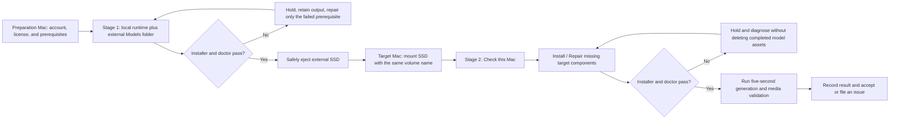

# InstallModel Two-Mac Testing Guide

**Status:** Operator and release test guide for InstallModel 0.2.3 (build 5)

**Audience:** Testers preparing MiniMax H3 model assets on one Apple Silicon Mac and completing setup on a second Apple Silicon Mac

## Purpose and capability boundary

This guide tests the complete handoff from a preparation Mac to a target Mac while keeping the large reusable model files on an external SSD. It covers the current `InstallModel.app` controls and the bundled installer.

Current behavior:

- detects the Mac chip, architecture, and unified memory;
- recommends a 24 GB, 64 GB, or 128 GB profile;
- installs or checks the local runtime and required command-line components;
- stores model assets in a separately selected external `Models` folder;
- reuses completed model files when the drive moves to another Mac; and
- runs the runtime doctor after installation;
- loads the generated environment safely and runs a configurable test clip from the Generate tab; and
- provides About and in-app Help windows with public documentation links.

Current limitations:

- Hugging Face account creation, license review, and `hf auth login` remain manual;
- operation logs are written under `~/Library/Logs/InstallModel`; preserve the revealed log for every test phase;
- Stop interrupts the observed process tree, but cancellation remains a hold point: confirm no `hf`, Python, or FFmpeg child remains before disconnecting storage;
- media stream validation and audiovisual acceptance remain manual after generation; and
- M2 Ultra 128 GB performance has not yet been measured.

Install / Repair preserves a patch before restoring its four installer-managed runtime files. Unrelated runtime files remain untouched. Do not place a Hugging Face token in the app, a command argument, a screenshot, or a test report.

## Test roles and evidence

| Stage | Machine or device | Purpose | Required evidence |
| --- | --- | --- | --- |
| 0 | Both Macs | Confirm prerequisites and identity | Chip, memory, macOS version, app commit, external-volume name |
| 1 | Preparation Mac | Download and prepare reusable model assets | Successful installer exit, doctor success, external model folders present |
| Handoff | External SSD | Carry model assets without changing the mount path | Same volume name, hidden Hugging Face metadata preserved, safe eject |
| 2 | Target Mac | Install local dependencies and reuse external assets | Read-only check, successful repair/install, target profile in environment file |
| Acceptance | Target Mac | Prove the installed runtime can generate valid media | MP4, `ffprobe` result, decode check, elapsed time, visual/audio review |

## Workflow



## Before testing

### Required hardware and storage

- Two Apple Silicon Macs. The supported workflow requires at least a 24 GB-class Mac; the installer rejects less than 20 GiB detected memory.
- A fast external SSD formatted as APFS, preferably Thunderbolt or USB4 NVMe.
- At least 200 GB free before initial preparation. Every model Install / Repair run requires at least 120 GiB and warns below the 200 GiB recommendation.
- AC power, adequate cooling, and enough uninterrupted time for a large download and model preparation.
- A stable Internet connection on both Macs.

Use a fictional label such as `Example-H3-Models` when documenting a test. The example model path in this guide is:

```text
/Volumes/Example-H3-Models/Models
```

Keep the same external-volume name on both Macs. The model files are portable, but the generated environment file and Python environment contain absolute paths.

### Obtain and record the software under test

For the public release, download the DMG and checksum from the [GitHub Releases page](https://github.com/macvfx/installModel/releases). Verify the checksum before opening it:

```bash
shasum -a 256 -c InstallModel-0.2.3-build5.sha256.txt
```

Drag `InstallModel.app` to Applications. The release must pass Gatekeeper without bypass instructions. In **InstallModel > About InstallModel**, confirm version 0.2.3 build 5.

Developers may instead build the current source revision locally:

From the repository checkout on each Mac, record:

```bash
git rev-parse HEAD
sw_vers
uname -m
system_profiler SPHardwareDataType
```

```bash
./scripts/build-app.sh debug
open "build/Debug/InstallModel.app"
```

The local Debug build requires an installed Swift/Xcode toolchain and is only ad-hoc signed. Record whether the test used the published release or a source-built Debug app.

### Prepare the Hugging Face account on each Mac

1. In the app, use the account button to open Hugging Face if an account is required.
2. Open the MiniMax H3 model page and personally review and accept the license.
3. Install Homebrew manually from its official site if `brew --version` fails.
4. Install the Hugging Face CLI if needed and authenticate in Terminal:

   ```bash
   brew install hf
   hf auth login
   hf auth whoami
   ```

Authentication is machine-specific. Repeat it on the target Mac. The app never asks for or stores the token.

## Stage 1: prepare models on the download Mac

1. Connect the APFS external SSD and confirm it appears in Finder with the intended volume name.
2. Launch `InstallModel.app`.
3. Confirm **Detected Mac** shows the expected chip, memory, `arm64` architecture, and recommended profile.
4. Optionally use the wand button to test the Magic theme. Theme choice does not change installer behavior.
5. Complete the Hugging Face and license steps, then select the license-confirmation checkbox.
6. Under **Choose workflow**, select **Stage 1: Prepare models**.
7. Set **Installation root** to a local path, for example:

   ```text
   /Users/example/MiniMax-H3-Prepare
   ```

8. Enable **Keep model files in a separate folder or external drive** and choose:

   ```text
   /Volumes/Example-H3-Models/Models
   ```

   Confirm the **Model files** capacity row names `Example-H3-Models`, labels it as an attached volume, shows its `/Volumes/Example-H3-Models` mount point, and reports that drive's free space. Disconnecting the drive must change the row to an invalid mounted-folder warning and disable **Install / Repair**.

9. Leave **Profile** set to **Automatic** unless the test plan explicitly requires a compatible override.
10. Click **Preview configuration**. Confirm the displayed chip, detected memory, selected profile, storage root, model directory, conditioner precision, and memory guideline.
11. Click **Check this Mac**. A failed check is expected before first installation. Save or copy the missing-item list into the test record.
12. Click **Install / Repair**. Keep the Mac awake, connected to power, and attached to the SSD. Do not disconnect the drive or quit the app while work is running.
13. Wait for exit code `0` and these final messages:

   ```text
   Installation and preflight completed.
   Saved paths and selected profile to: <local-root>/minimax-h3-paths.env
   ```

14. Confirm the doctor output reports success and the external `Models` folder contains these top-level directories:

   ```text
   MiniMax-H3
   MiniMax-H3-MLX-Argus-Calibrated-INT8
   MiniMax-H3-MLX-TextEncoder-4bit or MiniMax-H3-MLX-TextEncoder-8bit
   MiniMax-H3-Turbo-v4-step600-EMA-MLX
   ```

15. Preserve the hidden `.cache/huggingface` metadata within downloaded model directories. Safely eject the SSD.

### Stage 1 acceptance

- [ ] Preview matched the preparation Mac.
- [ ] The initial check identified missing components without modifying them.
- [ ] Install / Repair finished with exit code `0`.
- [ ] Runtime doctor passed.
- [ ] Large model directories are on the external SSD.
- [ ] `minimax-h3-paths.env` is under the local installation root.
- [ ] The external SSD was safely ejected.

## Stage 2: set up the target Mac

1. Connect the prepared SSD to the target Mac.
2. Confirm the drive mounted with exactly the same volume name used during Stage 1.
3. Install the same signed release on the target Mac, or build and record the same source revision when performing development testing.
4. Authenticate the target Mac with `hf auth login` and confirm `hf auth whoami` succeeds.
5. Confirm **Detected Mac** reports the target chip, memory, architecture, and recommended profile.
6. Select the license-confirmation checkbox.
7. Under **Choose workflow**, select **Stage 2: Set up target Mac**.
8. Choose a local target installation root, for example:

   ```text
   /Users/example/MiniMax-H3
   ```

9. Select the existing external model folder:

   ```text
   /Volumes/Example-H3-Models/Models
   ```

   Confirm the **Model files** capacity row resolves to the attached SSD and reports at least 120 GiB free; 200 GiB remains recommended. Do not continue if it displays the internal volume or an unmounted-folder warning.

10. Leave the profile on **Automatic** for the primary acceptance run.
11. Click **Preview configuration** and record the target profile. Expected examples are:

    | Target memory | Expected profile | Conditioner | Memory guideline |
    | ---: | --- | ---: | ---: |
    | 24 GB | `24gb` | 4-bit | 16 GB |
    | 64 GB | `64gb` | 8-bit | 48 GB |
    | 128 GB | `128gb` | 8-bit | 104 GB |

12. Click **Check this Mac**. Missing local runtime, Python environment, or Homebrew components are expected on a new target. Existing external model files should be reported as present when their required manifests are complete.
13. Click **Install / Repair**. The installer checks the existing downloads, installs missing local components, creates the target runtime and Python environment, builds a missing conditioner precision if necessary, writes target-specific settings, and runs the doctor.
14. Wait for exit code `0` and the completion messages.
15. Click **Check this Mac** again with the same paths. It must finish with:

    ```text
    [check] READY: all requested checks passed.
    ```

### Expected cross-profile behavior

- A preparation Mac with 48 GB or more creates the 8-bit conditioner used by the 64 GB and 128 GB profiles.
- A 24 GB preparation Mac creates a 4-bit conditioner. A 64 GB or 128 GB target reuses the downloaded BF16 source and builds the additional 8-bit conditioner locally.
- Reusing the external model folder does not mean nothing will download. The official repository is checked for missing or changed files; the community transformer and Turbo adapter use pinned revisions.

## Final target-Mac generation test

Installation and doctor success prove readiness, not audiovisual quality. In the app:

1. Open **Generate** and load the target installation root's `minimax-h3-paths.env`.
2. Confirm the displayed hardware profile, memory limit, MP4 path, and JSON path.
3. Use the canonical fox prompt from [the README](../README.md#first-comparable-smoke-test), output name `fox-test`, resolution `768x448`, duration `5`, steps `9`, and seed `42`.
4. Leave **Require a muxed MP4** enabled and retain the installed memory/stream settings for the first comparison.
5. Choose a new output name if either destination already exists; the app intentionally refuses to overwrite results.
6. Select **Generate clip**, retain the complete console output, then use **Reveal MP4** and **Reveal JSON**.

The equivalent Terminal command remains documented in the README for diagnosis and reproducibility. Installation and app generation do not replace media validation.

For manual validation, load the environment in Terminal:

```bash
source "/Users/example/MiniMax-H3/minimax-h3-paths.env"
cd "$MINIMAX_H3_RUNTIME"
```

Retain this evidence:

- complete generation console output;
- generated MP4 and forward-profile JSON;
- elapsed time and seconds per denoiser step;
- `ffprobe` stream and duration output;
- full FFmpeg decode result;
- confirmation that video plays, audio is present, motion is coherent, and no text or watermark appeared; and
- machine chip, unified memory, profile, resolution, duration, steps, and seed.

The historical 64 GB M1 Max observation was 24.6 minutes for a 5.17-second 768×448 clip using the documented quality baseline. Treat that as one prior observation, not a guaranteed target. Record the M2 Ultra result rather than assuming it will scale by memory size alone.

## Failure and recovery

| Symptom | Hold action | Recovery |
| --- | --- | --- |
| Homebrew missing | Stop before installation | Install Homebrew manually from its official site, relaunch, and rerun Check |
| `hf auth whoami` fails | Do not enter a token in the app or report | Run `hf auth login` in Terminal, verify `whoami`, then rerun |
| `401`, `403`, or gated-model error | Preserve output and confirm license/account | Review model access in the browser and reauthenticate |
| Less than 120 GiB free | Do not start model preparation | Free space or choose another APFS SSD |
| Drive disconnects or mount name changes | Stop and do not create a replacement folder at the old path | Reconnect under the original volume name, verify the folder, and rerun |
| App exits or download is interrupted | Preserve partial files and output | Rerun Install / Repair with the identical paths; downloads are designed to resume/check existing files |
| Existing runtime has local changes | Do not discard the changes | Inspect or preserve that checkout before continuing |
| Conditioner folder is partial | Do not delete it without reviewing the failure | Move it aside manually after preserving evidence, then rerun |
| FFmpeg references `/opt/local` | Do not rely on PATH-selected MacPorts FFmpeg | Use the environment file's explicit Homebrew FFmpeg path in the smoke-test command |
| Check still reports missing files | Record the exact missing path | Rerun Install / Repair; if repeated, file an issue with redacted output |

## Test record template

```text
App commit:
Preparation Mac chip / memory / macOS:
Target Mac chip / memory / macOS:
External SSD filesystem / free space:
Fictionalized volume label used in report:
Stage 1 profile / exit code / doctor result:
Stage 1 elapsed time:
Stage 2 initial check result:
Stage 2 profile / exit code / doctor result:
Stage 2 final check result:
Generation resolution / duration / steps / seed:
Generation elapsed time / seconds per step:
MP4 video stream / audio stream / duration:
Decode result:
Visual and audio review:
Unexpected behavior:
```

Before sharing a test report publicly, replace real usernames, volume names, and local paths with fictional values. Never include tokens or authentication files.

## Complete acceptance checklist

- [ ] Same app commit tested on both Macs.
- [ ] Both machines reported Apple Silicon `arm64` and the expected memory.
- [ ] Hugging Face login and license review completed separately on both Macs.
- [ ] External SSD was APFS with adequate free space.
- [ ] Stage 1 completed with doctor success.
- [ ] SSD moved using the same volume name and hidden metadata was preserved.
- [ ] Stage 2 reused the external model assets.
- [ ] Target-specific runtime, environment, and profile were written locally.
- [ ] Final read-only check reported READY.
- [ ] Five-second MP4 contained valid video and audio streams.
- [ ] FFmpeg decoded the entire file without error.
- [ ] Clip received a manual audiovisual review.
- [ ] Timings, profile, and anonymized evidence were retained.

## Related documentation

- [Installer and app README](../README.md)
- [Detailed MiniMax H3 Mac setup guide](MINIMAX_H3_MAC_SETUP_GUIDE.md)
- [Development backlog](BACKLOG.md)
- [Changelog](../CHANGELOG.md)
- [0.2.0 release notes](RELEASE_NOTES_0.2.0.md)
- [0.2.1 private test release notes](RELEASE_NOTES_0.2.1.md)
- [0.2.2 private test release notes](RELEASE_NOTES_0.2.2.md)
- [0.2.3 private test release notes](RELEASE_NOTES_0.2.3.md)
